# Menu Maison : brief, flux et tutoriel

Document de référence pour présenter l'app, former un nouveau membre et préparer
l'onboarding (section 6). Captures faites le 28 octobre 2026 sur une famille de démonstration
(« Martin » : Julie admin, Marc admin, Léa membre), données fictives, thème Carotte.
Smartphone en 390 × 844, ordinateur en 1440 × 900. Captures de l'onboarding (`ob-*`) :
famille de démonstration « Démo Guide » (Alex admin, Sam membre), 390 × 844 et 1280 × 800.

---

## 1. Le brief en une page

**Ce que c'est.** Une app web (installable sur l'écran d'accueil) pour qu'une famille
décide ensemble de ce qu'elle mange dans la semaine, et en tire automatiquement une
liste de courses rangée dans l'ordre des rayons du magasin où elle va.

**Pour qui.** Une famille de 2 à 12 profils. Les adultes planifient et font les courses,
les enfants peuvent liker des recettes et noter leurs envies. Un ou plusieurs admins
gèrent les comptes et l'apparence.

**Le problème réglé.**

| Avant | Avec Menu Maison |
|---|---|
| « On mange quoi ce soir ? » tous les jours | La semaine est planifiée d'un coup, avec les envies de chacun |
| Liste de courses écrite à la main, oublis | Liste calculée depuis les menus, quantités additionnées |
| On tourne dans le magasin | Liste triée dans l'ordre des rayons de **ce** magasin |
| Restes oubliés au fond du frigo | Le Frigo dit jusqu'à quand c'est bon et propose de les replacer |
| Ingrédients achetés pour un plat annulé | « Pas cuisiné » les garde dans « À utiliser », avec des idées de recettes |
| Toujours les mêmes plats | Statistiques et alerte « déjà mangé cette semaine » |

**Les principes.**

1. **Une semaine = du jour des courses au jour d'avant.** Par défaut samedi à vendredi.
   Tout tourne autour de ce cycle.
2. **On planifie des portions, l'app calcule le reste.** Quantités par portion dans les
   recettes, multipliées puis additionnées sur la liste.
3. **Une cuisson peut nourrir plusieurs repas.** Le souper et le midi du lendemain, ou des
   portions en plus pour le frigo.
4. **Tout se sauvegarde tout de suite et se synchronise en temps réel** sur les téléphones
   de la famille (on peut faire les courses à deux).
5. **Mobile d'abord.** L'ordinateur ajoute un espace « Gestion » avec des tableaux.

**Coûts.** Tout est gratuit sauf deux options payées à l'usage par l'app : lecture des
tickets de caisse et import de recettes par Claude (quelques centimes par lecture),
dictée par Groq (offre gratuite).

---

## 2. Les mots de l'app

| Terme | Ce que ça veut dire |
|---|---|
| **Semaine** | 7 jours à partir du jour des courses (réglable dans Réglages) |
| **Créneau** | Matin, midi ou soir d'un jour |
| **Plat** ou **repas** | Une recette (ou un texte libre) posée sur un créneau, avec un nombre de portions |
| **Portions en plus** | Cuisinées avec le plat, achetées avec lui, rangées au Frigo pour plus tard |
| **Restes** | Portions déjà cuisinées qu'on replace sur un autre créneau : jamais sur la liste de courses |
| **Statut** | Prévu, Mangé, Pas mangé (cuisiné mais pas mangé, va au Frigo), Il en reste, Pas cuisiné |
| **À utiliser** | Ingrédients achetés pour un plat pas cuisiné, gardés à la maison (Frigo) |
| **Nos recettes** | Les recettes que la famille garde ; « Découvrir » montre le reste du catalogue |
| **Envie** | Un plat qu'un membre aimerait manger bientôt |
| **Menu type** | Une semaine enregistrée qu'on réapplique en un tap |
| **Article habituel** | Produit hors recette (papier toilette, café…) ajouté à la liste en un tap |
| **Souvent en stock** | Ingrédient qu'on a en général (épices, huiles…), proposé en haut de la validation |
| **Admin** | Gère profils, pseudos, rôles, liens d'accès, nom et apparence de la famille |

---

## 3. Carte des écrans

### Smartphone : 5 onglets en bas

```
Semaine ─┬─ Ajouter un plat ─ options (portions, demain midi, en plus, répéter)
         ├─ Fiche d'un plat ─ statut, portions, déplacer, pas cuisiné, retirer
         ├─ Valider le menu de la semaine
         └─ Menus types (icône en haut à droite)
Courses ─┬─ choix du magasin, cocher, « Reste à acheter »
         ├─ Articles habituels, ajout libre, fiche d'un article (⋯)
         └─ Scanner le ticket de caisse (bas de la liste)
Recettes ┬─ Nos recettes / Découvrir, filtres par style
         ├─ Fiche recette (likes, coût, stats, ingrédients, étapes)
         └─ Nouvelle : écrire, dicter ou importer
Frigo ───── À utiliser, Restes (planifier, jeté)
Plus ────┬─ Envies, Menus types, Statistiques
         ├─ Produits, Magasins (ordre des rayons)
         └─ Réglages (famille, profils, jour des courses, magasin par défaut, rayons)
```

### Ordinateur

Les mêmes onglets en haut de page, plus un onglet **Gestion** (`#/gestion`), visible
seulement sur grand écran : menu latéral, tableaux triables, fiches en panneau à droite.

| Section | Pour qui | Contenu |
|---|---|---|
| Recettes | Tous | Tableau des 61 recettes (temps, coût, conservation, dernière fois), import, éditeur sur deux colonnes |
| Produits | Tous | Ingrédients et articles hors recette, filtres (sans prix, sans photo…) |
| Rayons | Tous | Ordre général des rayons |
| Magasins | Tous | Parcours de chaque magasin, enseigne, niveau de prix, magasin par défaut |
| Famille | Admins | Nom et lien, comptes (pseudo, rôle, accès), apparence (thème, police) |
| Super admin | PA seul | Familles de l'app (hors de ce guide) |

---

## 4. Les flux, dans l'ordre d'une vraie semaine

Le cycle : **(0) entrer dans l'app** une fois, puis chaque semaine **(1) planifier →
(2) valider → (3) faire les courses → (4) scanner le ticket → (5) vivre la semaine →
(6) gérer les restes**. Les flux 7 à 10 se font quand on veut.

### Flux 0. Entrer dans l'app (une seule fois)

**Côté admin**
1. Plus, Réglages, Profils : « Ajouter un profil » (prénom, emoji ou photo, couleur).
2. Dans la fiche du profil, section **Accès** : choisir le pseudo, le rôle (Membre ou
   Admin), puis « Créer son lien d'activation ».
3. Envoyer le lien par message (bouton de partage). Il vaut 14 jours.

**Côté nouveau membre**
4. Ouvrir le lien : l'écran « Bienvenue » montre son pseudo, il choisit son mot de passe
   (8 caractères au moins) et c'est parti.
5. Sur iPhone : Safari, Partager, « Sur l'écran d'accueil ». Sans ça, Safari peut
   effacer la connexion après 7 jours sans visite.
6. Les fois suivantes : le lien de la famille (`menumaison.ch/#/f/<famille>`) ou le nom
   de la famille, le pseudo, le mot de passe. Connexion gardée 365 jours.

Mot de passe oublié : « Mot de passe oublié ? » sur l'écran de connexion envoie un lien de
2 heures à l'adresse e-mail confirmée du profil. Sans adresse, un **autre** admin crée un
nouveau lien depuis la même section.

Réglages, **Mon compte** (chaque membre) : adresse e-mail (facultative, confirmée par un lien),
changement de mot de passe, déconnexion des autres appareils. Réglages, **Données de la
famille** (admins) : export JSON de toutes les données, et suppression définitive de la famille
(nom de la famille et mot de passe demandés, abonnement arrêté d'abord).

<p>
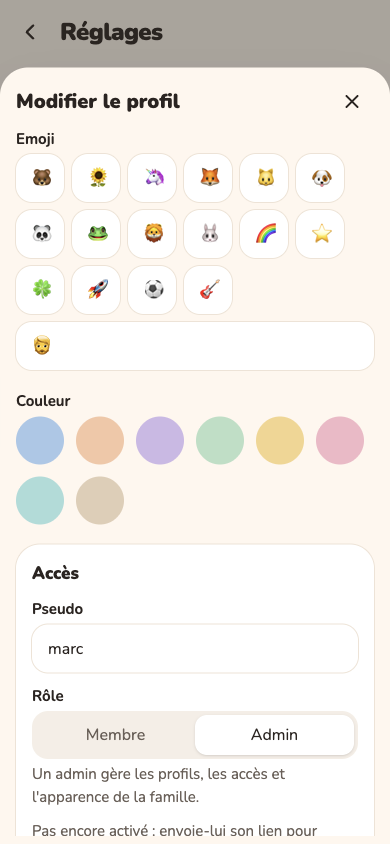
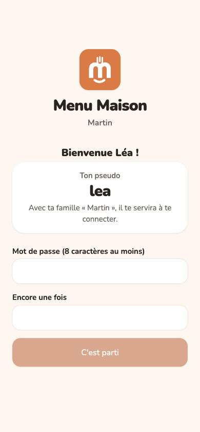
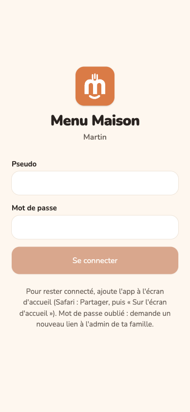
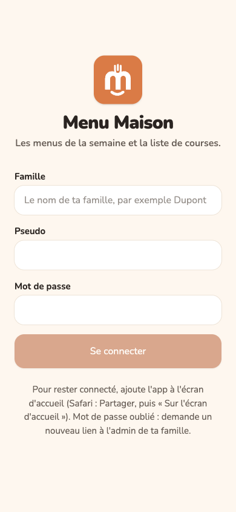
</p>

### Flux 1. Planifier la semaine

Écran **Semaine** : le résumé en haut (plats prévus, coût estimé, bouton « Liste de
courses »), les **Envies** de la famille, puis chaque jour avec ses créneaux.

1. Regarder les envies (bandeau du haut) pour s'en inspirer.
2. Option rapide : icône en haut à droite, **Menus types**, « Appliquer » une semaine
   enregistrée.
3. Sinon, sur un créneau vide : **+ Ajouter**. Le choix du plat s'ouvre :
   - onglets Nos recettes, Tout, Envies, et en tête les **restes à finir** encore bons ;
   - recherche et styles (#Express, #Familial…) ;
   - un badge prévient si le plat est déjà prévu ou mangé récemment.
4. Choisir le plat, puis régler :
   - **portions** du repas ;
   - **Aussi pour demain midi** (le soir) : une seule cuisson, deux repas, quantités
     additionnées ;
   - **Préparé la veille au soir** (le midi) ;
   - **En plus pour le frigo** : portions à manger plus tard ;
   - **Répéter ce plat** : mêmes jours, 1 à 12 semaines (le birchermüesli de chaque matin).
5. « Ajouter au menu ». La liste de courses se met à jour toute seule.

<p>
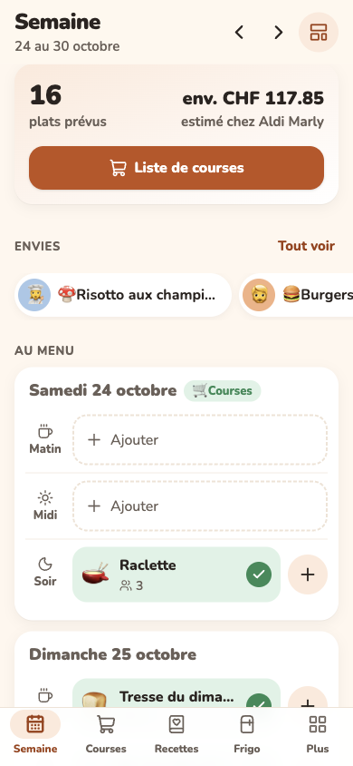
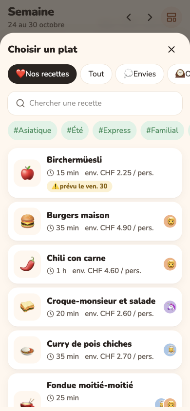
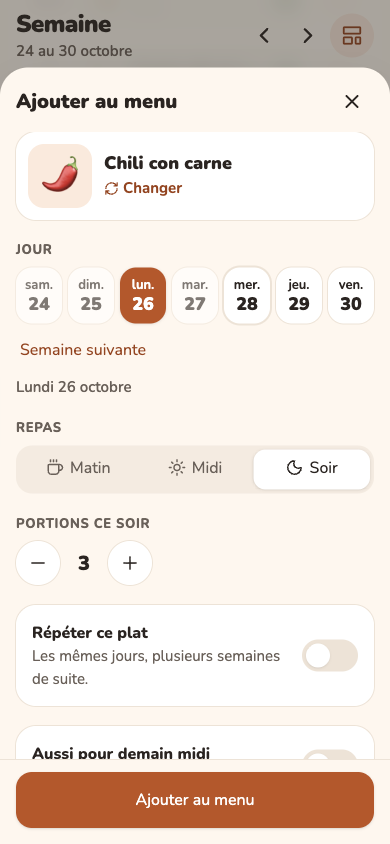
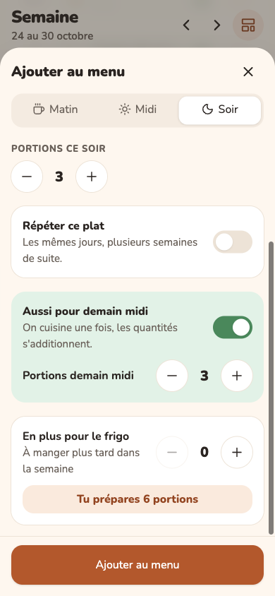
</p>

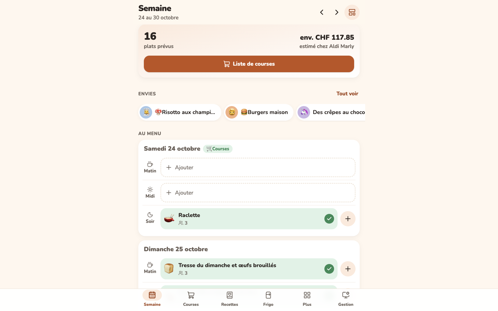

### Flux 2. Valider le menu de la semaine

Bouton **Valider le menu de la semaine** en bas de la Semaine.

1. Tous les ingrédients de la semaine, une fois chacun, quantité totale, tout coché.
2. Les « souvent en stock » sont en haut, le frais en bas.
3. **Décocher ce qu'on a déjà** : ça sort entièrement de la liste (pas de quantité
   partielle).
4. « Valider : n articles à acheter ». Dans Courses, ce qui a été décoché reste visible
   dans « Déjà à la maison », avec « Remettre ».

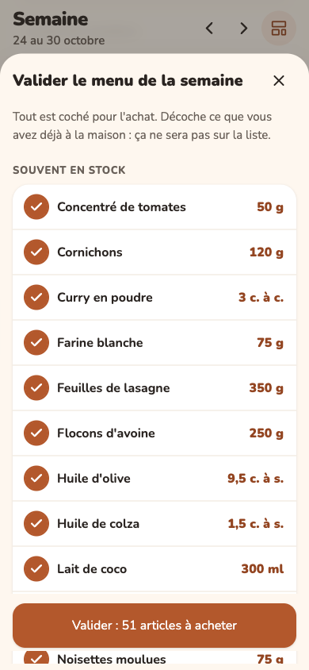

### Flux 3. Faire les courses

Onglet **Courses**.

1. Choisir le **magasin** en haut (Aldi Marly, Coop Fribourg Centre…) : la liste se
   réordonne dans l'ordre de ses rayons.
2. Compteur et barre de progression, coût estimé chez ce magasin.
3. Toucher un article pour le **cocher** ; l'avatar de qui l'a coché s'affiche. Les
   coches arrivent en direct sur les autres téléphones.
4. **Reste à acheter** pour ne voir que ce qui manque.
5. Ajouter un article libre (champ « Ajouter un article », quantité « Qté ») ou ouvrir
   **Articles habituels** pour les ajouter en un tap.
6. Bouton **⋯** d'un article libre : quantité, retirer de la liste. Toucher l'icône d'un
   article de recette : changer son rayon dans ce magasin.
7. Un article « disponible seulement chez » une autre enseigne part en bas, dans
   « À acheter chez … ».

<p>
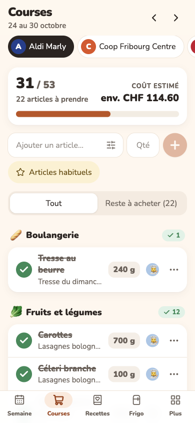
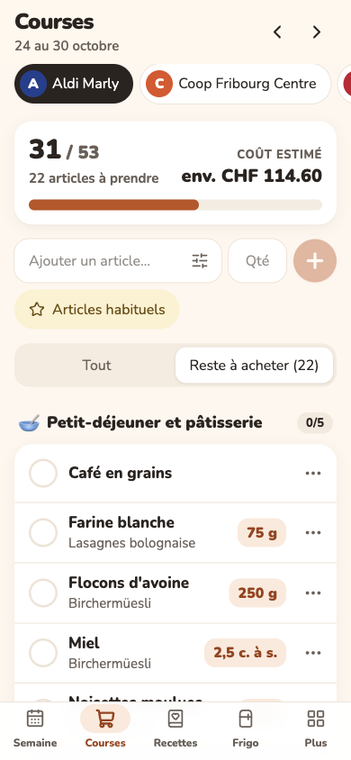
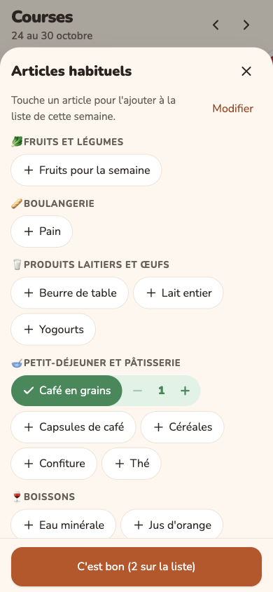
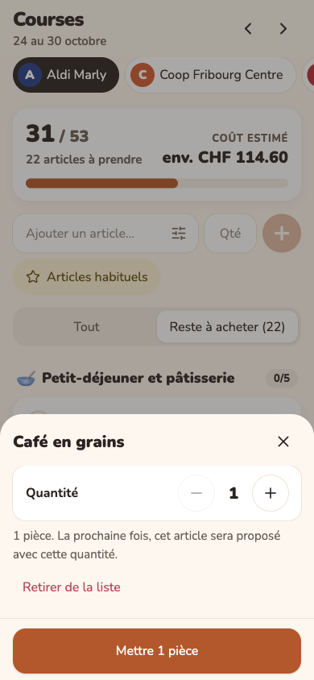
</p>

### Flux 4. Scanner le ticket de caisse (facultatif)

En bas de la liste : **Scanner le ticket de caisse**. Photo du ticket, l'app lit les
lignes, on vérifie, et les **prix réels par enseigne** remplacent les estimations. La photo
n'est pas gardée, les numéros de carte sont écartés.

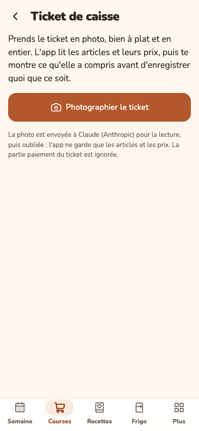

### Flux 5. Pendant la semaine : dire ce qui s'est passé

Toucher un plat dans la Semaine ouvre sa **fiche** :

| Bouton | Quand | Effet |
|---|---|---|
| **Prévu** | Par défaut, ou pour revenir en arrière | Reprend ses ingrédients |
| **Mangé** | Le plat a été mangé | Compte dans les statistiques |
| **Pas mangé** | Cuisiné, pas mangé | Tout part au Frigo |
| **Il en reste** | Mangé, avec un reste | On indique combien de portions, elles vont au Frigo |
| **Pas cuisiné** | Annulé, jamais cuisiné | Sort de la liste ; ce qui était acheté va dans « À utiliser » |
| **Déplacer** | On le fera un autre jour | Choisir le jour et le créneau |
| **Retirer du menu** | Erreur de planification | Supprime le plat |

Pour **Pas cuisiné**, l'app explique l'effet puis liste les ingrédients : ceux déjà
cochés sur la liste sont proposés comme « Déjà à la maison ». On coche ce qu'on a
vraiment, on confirme. Le souper et le midi du lendemain cuisinés ensemble sont annulés
ensemble, avec un seul stock « À utiliser » pour toutes leurs portions.

<p>
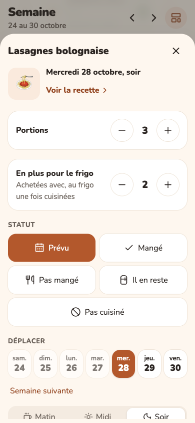
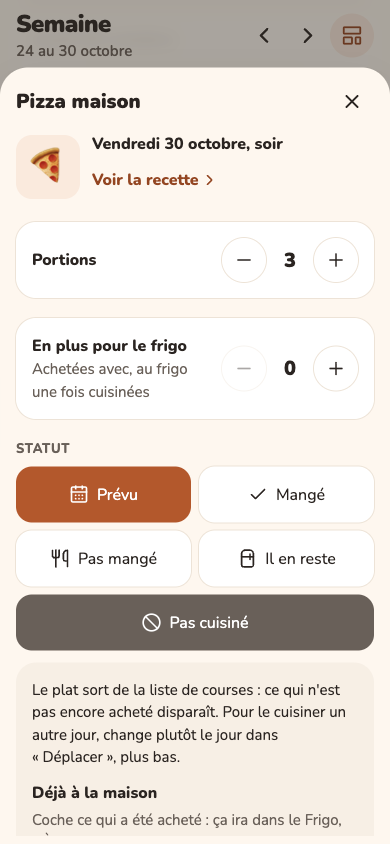
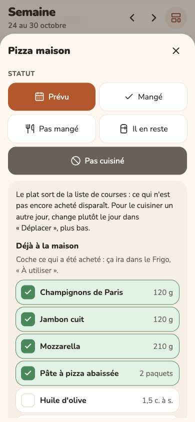
</p>

### Flux 6. Le Frigo : finir les restes

Onglet **Frigo**, deux blocs :

- **À utiliser** : ingrédients d'un plat pas cuisiné (« Tofu nature, 300 g, depuis le
  dim. 25 »), avec **des idées de recettes** qui les utilisent et « Utilisé ou jeté ».
  Pas de date limite : l'app dit depuis quand, la famille juge.
- **Restes** : plats cuisinés pas finis, portions, **bon jusqu'au** (selon la durée de
  conservation de la recette). « Planifier » les pose sur un créneau (sans courses),
  « Jeté » les retire.

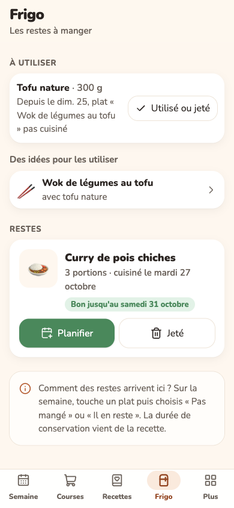

### Flux 7. Les recettes

Onglet **Recettes** : **Nos recettes** (celles qu'on garde) et **Découvrir** (le reste
du catalogue de départ, 61 recettes suisses et familiales).

- Fiche recette : photo ou emoji, temps, conservation, styles, **likes de chaque
  membre** (toucher son portrait), combien de fois mangée, ingrédients avec prix
  estimés, coût total, allergènes et nutrition (Open Food Facts), étapes.
- **Nouvelle** : écrire la recette (emoji ou photo, ingrédients par portion, étapes,
  styles), ou **Dicter ou importer** :
  - **Dicter** : parler jusqu'à 5 minutes, l'app transcrit et prépare un brouillon ;
  - **Importer** : coller un lien (Fooby, Betty Bossi, Marmiton…) ou le texte ; le
    brouillon s'ouvre dans l'éditeur, à vérifier puis enregistrer.

<p>
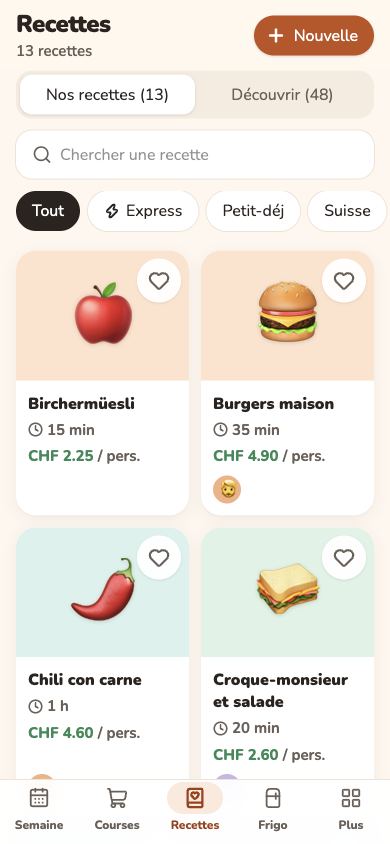
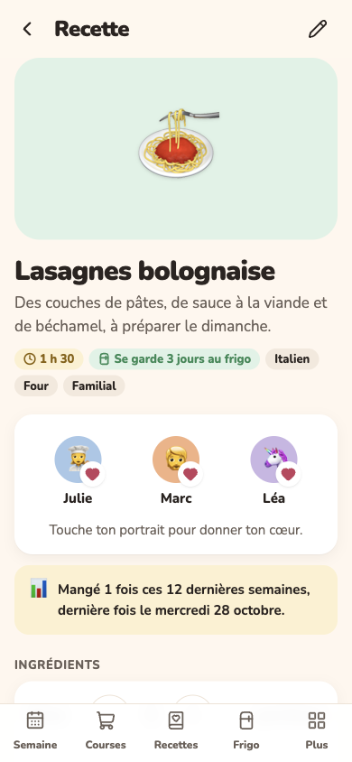
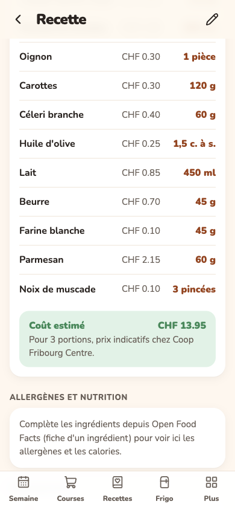
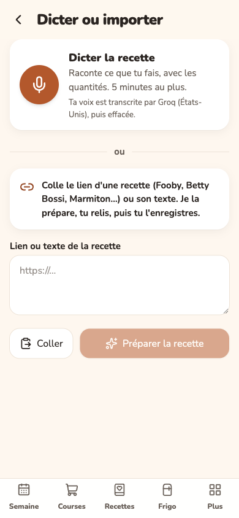
</p>

### Flux 8. Les envies

Plus, **Envies** : chacun note un plat (texte libre ou recette). Elles s'affichent en
haut de la Semaine. « Planifier » pose le plat sur un créneau, « Fait » la retire.

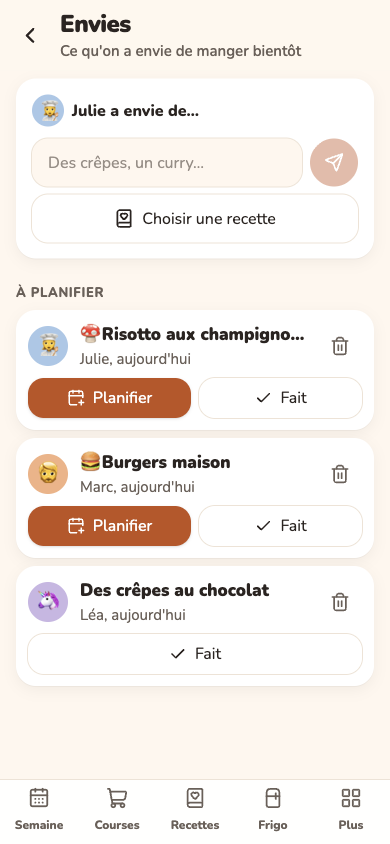

### Flux 9. Menus types et statistiques

- **Menus types** : « Enregistrer cette semaine comme menu type », puis plus tard
  « Appliquer » sur une autre semaine.
- **Statistiques** : plats cuisinés cette semaine et en 4 semaines, plats trop
  fréquents, top des 12 dernières semaines, plats aimés mais oubliés.

<p>
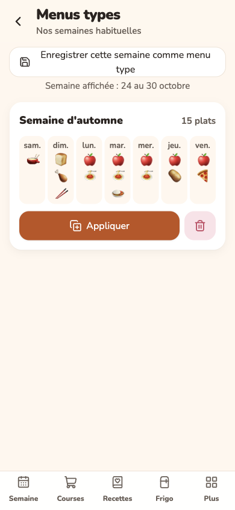
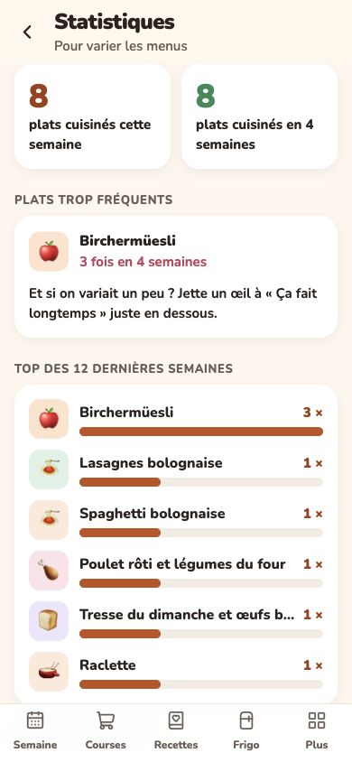
</p>

### Flux 10. Réglages et magasins (une fois, puis rarement)

- **Réglages** : nom de la famille et lien de connexion à partager, profils, **jour des
  courses**, magasin par défaut, rayons et ingrédients « souvent en stock »,
  déconnecter ce téléphone.
- **Magasins** : niveau de prix par rapport à la moyenne, étoile du magasin par défaut,
  et pour chacun le **parcours** : ordre des rayons de l'entrée à la caisse.
- **Produits** : tous les ingrédients et articles, avec filtres (sans prix, sans photo,
  par rayon ou enseigne).

<p>
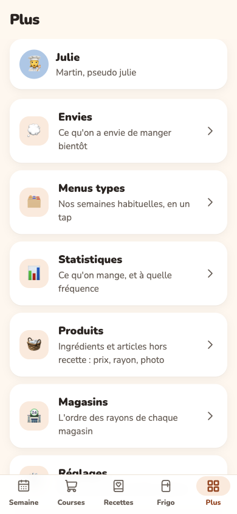
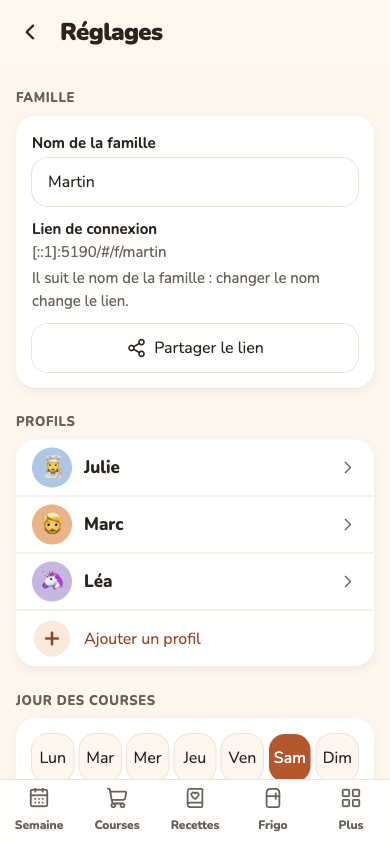
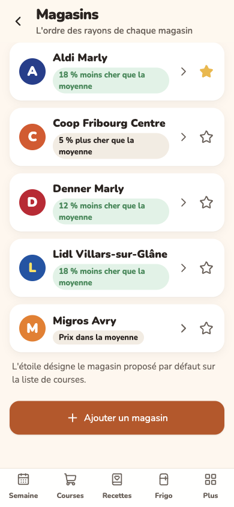
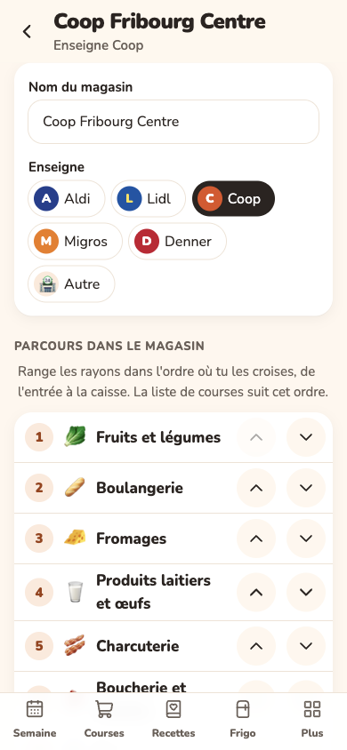
</p>

### Flux 11. La gestion sur ordinateur

Onglet **Gestion** (grand écran). Utile pour les travaux de fond : compléter les prix,
corriger des recettes, ordonner les rayons, gérer les comptes.

**Famille (admins)** : nom et lien de connexion, tableau des comptes (pseudo, rôle,
accès « Activé » ou « Pas encore activé »), fiche d'un profil en panneau, et
**Apparence** : trois thèmes (Carotte, Sauge, Myrtille) et quatre polices, appliqués tout
de suite sur tous les téléphones.

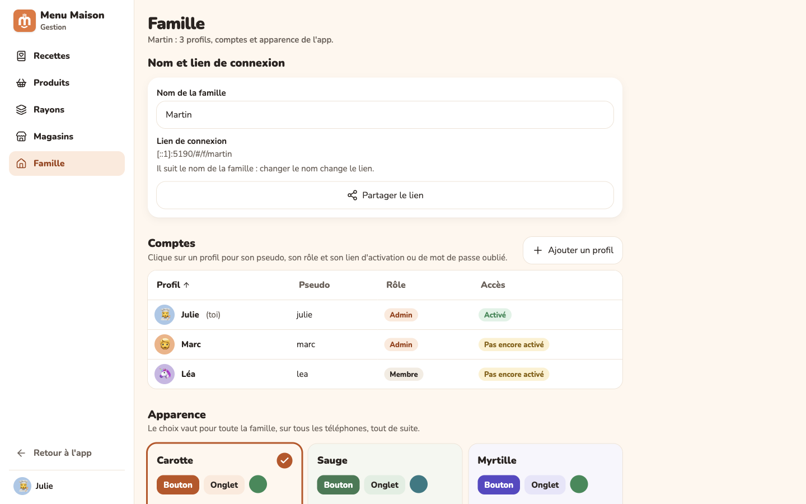
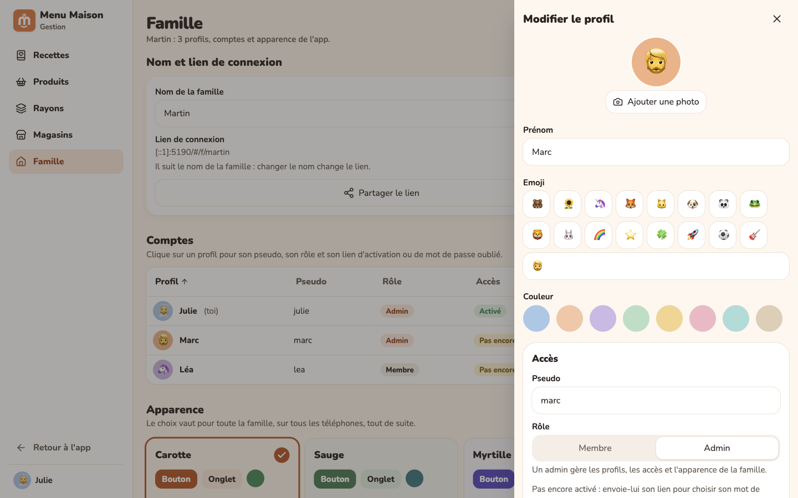
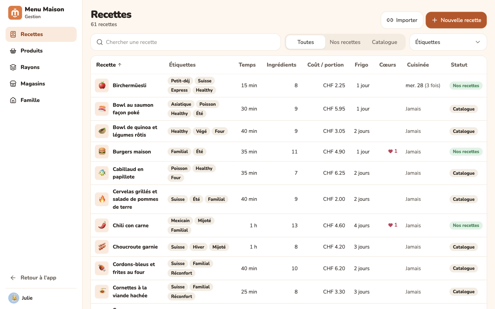
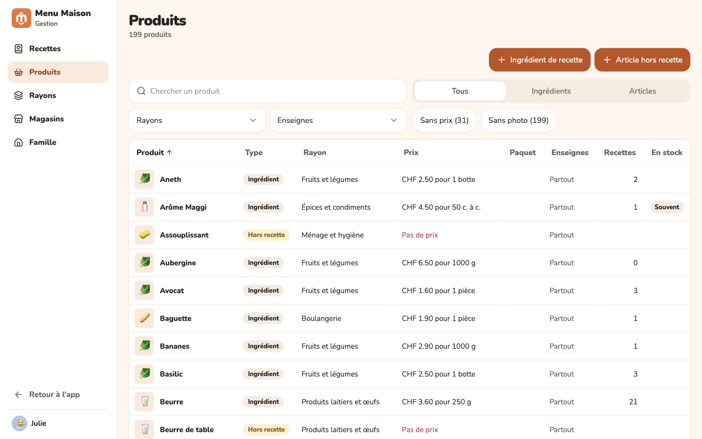
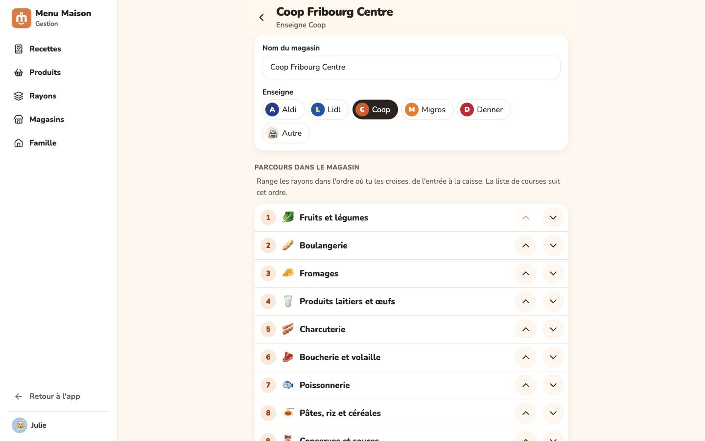

Autres captures : `captures/d-*.png` (Semaine, Courses, Recettes, Frigo, Plus, Rayons,
Magasins, éditeur de recette, import) et `captures/m-*.png`.

---

## 5. Tutoriel : l'ordre conseillé pour un nouveau

### Pour un membre (10 minutes)

| Étape | Où | Ce qu'il fait |
|---|---|---|
| 1 | Lien reçu | Choisit son mot de passe, ajoute l'app à l'écran d'accueil |
| 2 | Plus, Réglages, son profil | Met sa photo ou son emoji |
| 3 | Recettes, Découvrir | Like 5 recettes qu'il aime (son portrait sur la fiche) |
| 4 | Plus, Envies | Note une envie |
| 5 | Semaine | Ajoute un plat sur un créneau vide |
| 6 | Courses | Coche un article, essaie « Reste à acheter » |
| 7 | Semaine, un plat passé | Le marque « Mangé » |

### Pour un admin (en plus, 15 minutes)

| Étape | Où | Ce qu'il fait |
|---|---|---|
| 1 | Réglages | Vérifie le nom de la famille, le jour des courses, le magasin par défaut |
| 2 | Réglages, Profils | Crée les profils, pseudos, rôles, envoie les liens |
| 3 | Magasins | Contrôle le parcours de son magasin habituel |
| 4 | Gestion, Famille (ordinateur) | Choisit le thème et la police |
| 5 | Semaine | Planifie une semaine complète, puis « Valider le menu » |
| 6 | Menus types | Enregistre la semaine comme menu type |

---

## 6. Onboarding des nouveaux (en place depuis le 2026-10-28)

Objectif : guider un nouveau sans gêner les habitués, et pouvoir le couper.

### Ce que voit un nouveau

- À la **première connexion** : une carte de bienvenue (« 1 minute pour faire le tour ? »),
  « Commencer » ou « Plus tard ».
- Puis **6 bulles** posées sur les vrais écrans, avec « Suivant » et « Passer » (Échap
  aussi) :
  1. Semaine : « Ici, les repas de la semaine. Touche « + Ajouter » pour poser un plat. »
  2. Choix du plat (le tour l'ouvre lui-même, rien n'est enregistré) : « Tes envies et les
     restes à finir sont en haut. »
  3. Fiche du plat (premier plat de la semaine ; s'il n'y en a pas, la bulle est au milieu
     de l'écran) : « Après le repas : Mangé, Pas mangé, Il en reste ou Pas cuisiné. »
  4. Courses : « La liste se fait toute seule, dans l'ordre des rayons de ton magasin. »
  5. Frigo : « Les restes, et ce qu'il faut utiliser avant que ça se perde. »
  6. Recettes : « Dans Découvrir, like ce que tu aimes : ça aide à choisir les plats de la
     semaine. »
- Pour un admin, **3 bulles de plus** : profils et liens (Réglages), jour des courses
  (Réglages), apparence (Gestion, Famille sur ordinateur ; sur téléphone, la bulle dit où
  la trouver).
- Dans **Plus**, la checklist **« Premiers pas »**, cochée toute seule d'après ce que la
  personne a fait, qui disparaît une fois complète : ajouter l'app à l'écran d'accueil
  (téléphone seulement, vu sur cet appareil), mettre sa photo, mettre un cœur à 5 recettes,
  noter une envie, ajouter un plat, cocher un article des courses, dire comment s'est passé
  un plat.

<p>
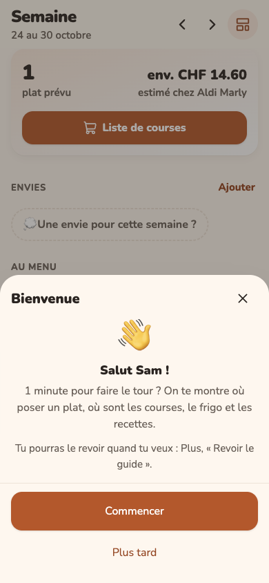
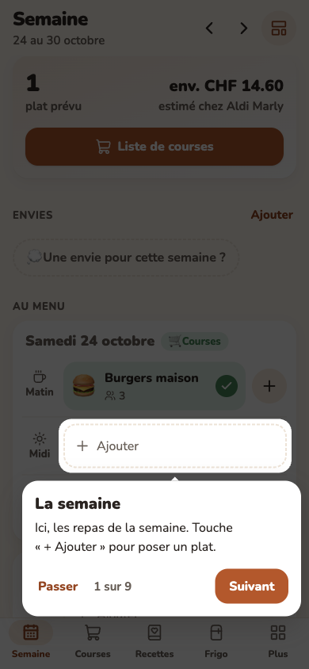
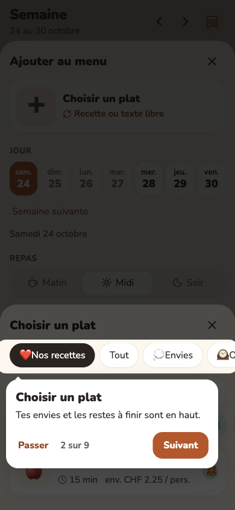
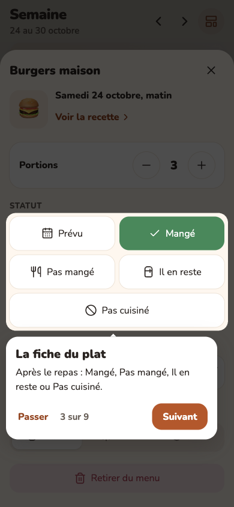
</p>
<p>
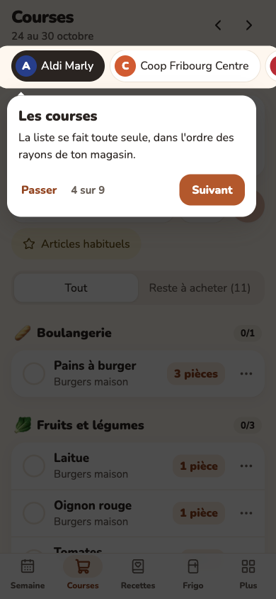
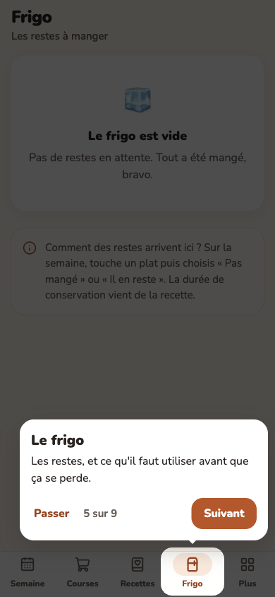
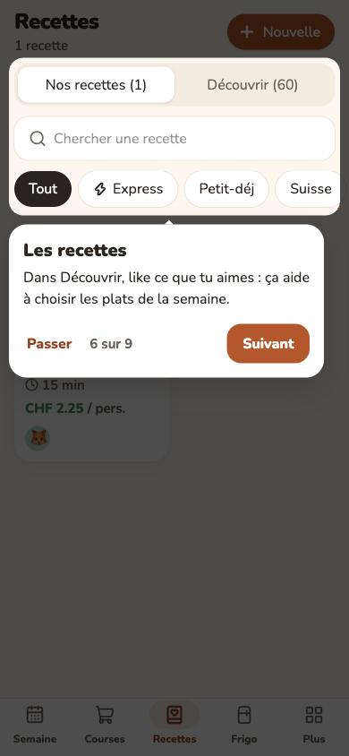
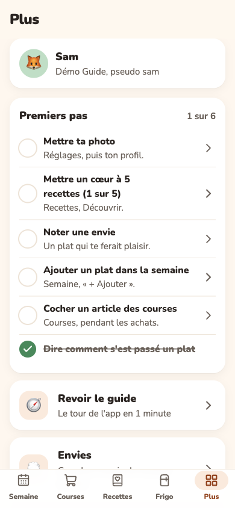
</p>
<p>
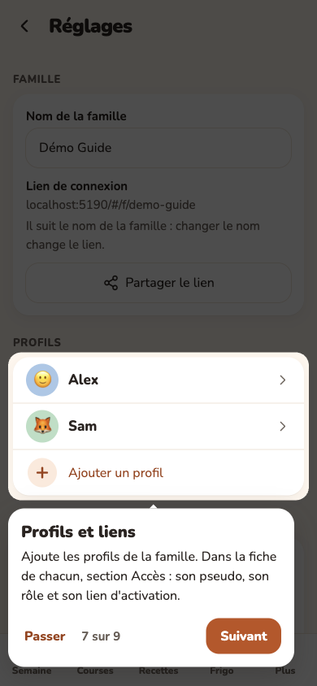
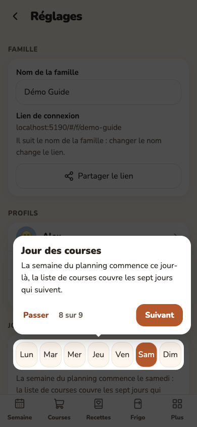
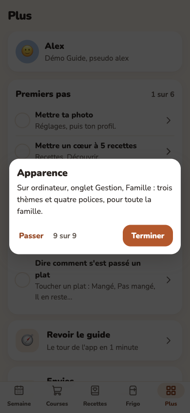
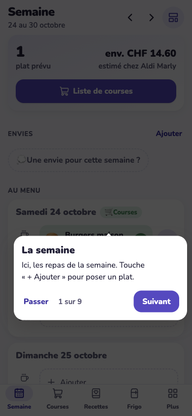
</p>

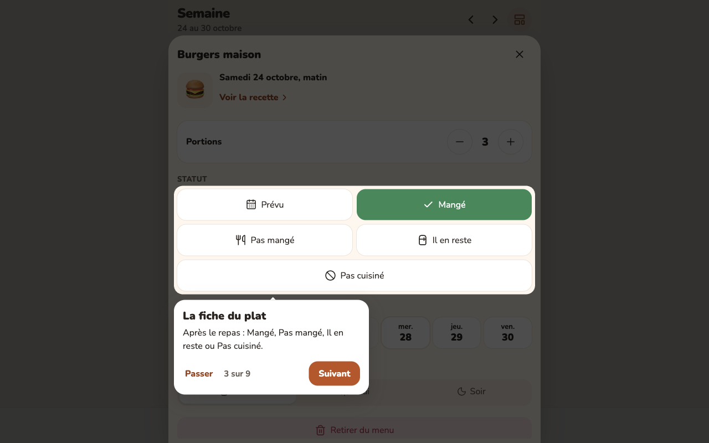
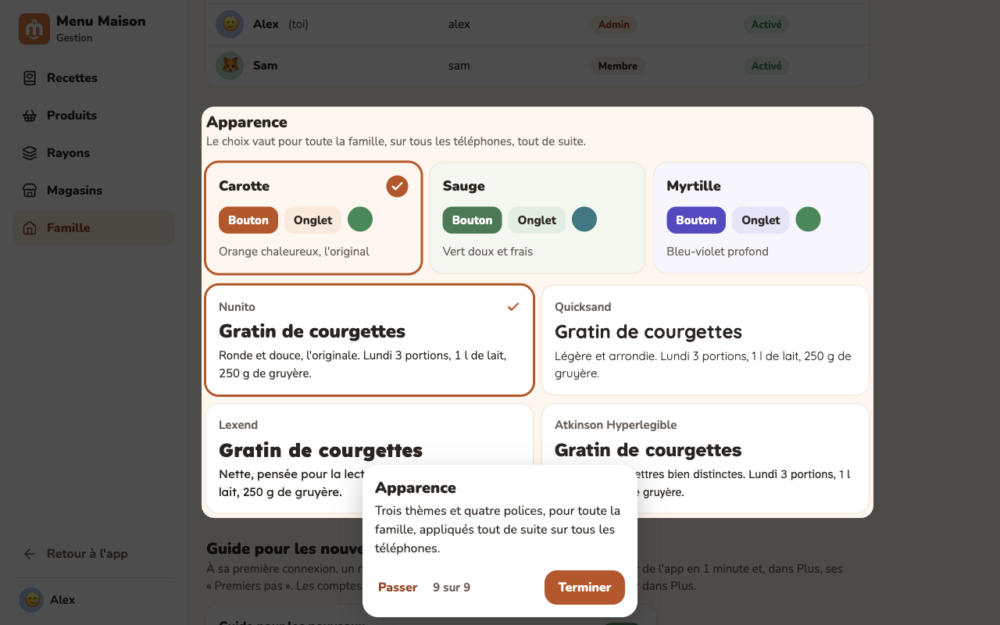

### Les deux interrupteurs

| Niveau | Où | Effet |
|---|---|---|
| **Famille** | Gestion, Famille, « Guide pour les nouveaux » (admins) | Active ou coupe l'onboarding pour la famille. Coupé : l'app est celle d'avant, rien n'est chargé |
| **Personne** | Plus, « Revoir le guide » | Relance le tour à la demande, même si c'est déjà fait |

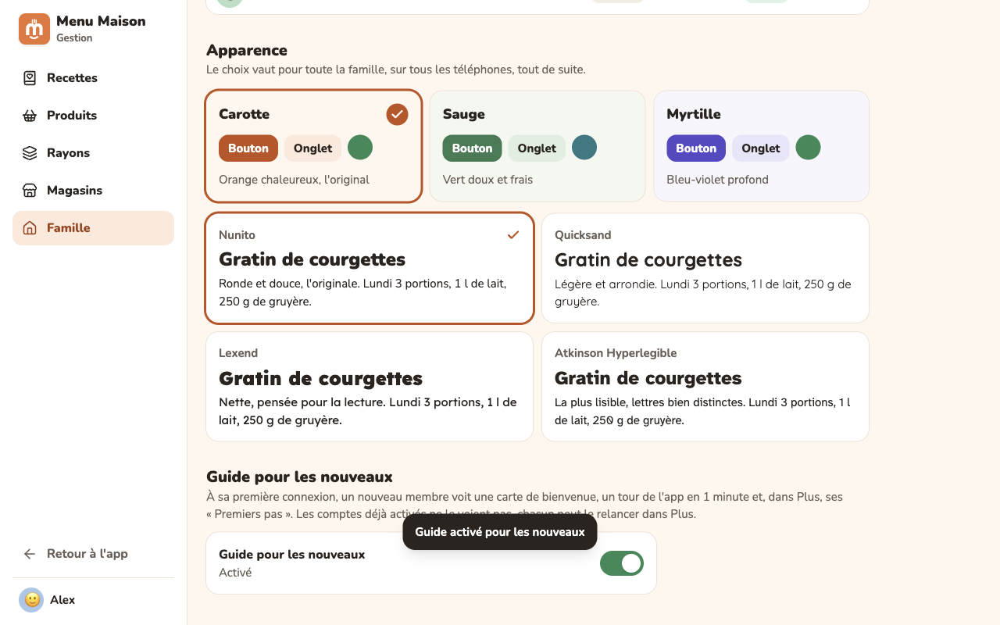

- Activé d'office pour les **nouvelles familles**. Les familles d'avant le 2026-10-28 l'ont
  coupé tant qu'un admin ne l'active pas.
- En l'activant, les comptes **déjà activés** sont marqués « habitués » : ni carte, ni tour,
  ni checklist (ils gardent « Revoir le guide »). Seuls les comptes activés ensuite voient
  la bienvenue.
- Une checklist complète le reste : la personne passe « habituée », même si elle retire un
  cœur ou décoche un article ensuite.
- Cas limite : couper puis réactiver le guide marque aussi « habitué » un compte activé
  entre-temps qui n'a pas encore ouvert l'app. Il garde « Revoir le guide » dans Plus.

### Comment c'est fait

- Librairie **driver.js 1.10.2** (MIT), choisie le 2026-10-28 face à Shepherd.js et Intro.js
  (AGPL ou licence payante), react-joyride (3 fois plus lourd) et Reactour (plus maintenu).
- Tout est dans `src/onboarding/`. Un seul branchement dans l'app : `<OnboardingGate />`
  dans `src/main.tsx`. Il décide avec les données déjà chargées (`catalog.base`) et ne
  télécharge le tour (environ 10 Ko gzip, CSS compris à part) que pour un nouveau ou sur
  « Revoir le guide ». « Premiers pas » est aussi chargé à la demande, dans Plus.
- Les bulles visent des attributs `data-tour` posés sur les écrans, sans changer leur
  structure ni leurs styles. Elles suivent le thème (`var(--color-…)`), texte de 16 px,
  boutons de 44 px.
- Données : `settings.onboarding`, `members.onboardingDoneAt` (0 = habitué),
  `meals.addedBy` et `meals.statusBy` (qui a ajouté le plat, qui a dit ce qui s'est passé).
  Logique dans `convex/domain/onboarding.ts`, fonctions dans `convex/onboarding.ts`.

## 7. Remarques relevées en faisant les captures

- « Ajouter un profil » reste visible dans Réglages pour un membre non admin (le serveur
  refuse l'action, mais le bouton ne devrait pas apparaître).
- Sur mobile, la liste des magasins dans Courses déborde à droite (on fait défiler) : à
  garder en tête si une famille en a beaucoup.
- Le bouton « Scanner le ticket de caisse » est tout en bas de la liste : peu visible
  pendant les courses.
